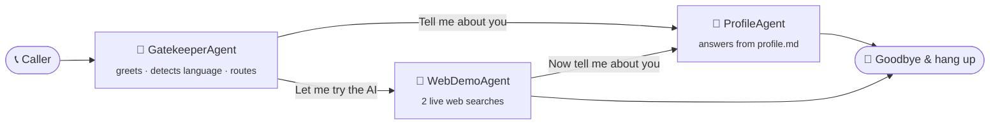

<div align="center">

# 📞 Voice Resume Agent

**Your resume, on a phone line.**
A voice AI agent that picks up the call and answers questions about you: your background, skills, projects and experience. Built for recruiters, clients and collaborators.

[](https://www.python.org/)
[](https://github.com/livekit/agents)
[](https://ai.google.dev/)
[](https://github.com/astral-sh/uv)
[](https://github.com/astral-sh/ruff)

[How it works](#-how-it-works) · [Quickstart](#-quickstart) · [Make it yours](#-make-it-yours) · [Configuration](#%EF%B8%8F-configuration) · [Testing](#-testing) · [Deploy](#-deploy)

</div>

---

## ✨ Features

- 🗣️ **Talks like a person.** It runs on a realtime speech-to-speech model (Gemini Live), with interruption handling and audio enhancement from ai-coustics.
- 🇮🇳 **Speaks the caller's language.** It greets in Hinglish, works out from the first reply whether the caller speaks English, Hindi or Hinglish, and keeps using that language after every handoff.
- 🧭 **Sends each caller to the right agent.** A small gatekeeper agent works out what the caller wants and hands the call to a specialist, so each prompt stays short and fast.
- 🔒 **Keeps your details private.** It never gives out your contact details, takes messages instead, and won't agree to salary, start dates or anything else on your behalf.
- 🔎 **Offers a live demo.** An optional web-search mode lets callers try the AI, capped at two questions per call.
- 📄 **Uses a plain Markdown resume.** Your profile lives in one gitignored file, so your personal data never ends up in the repo.

## 🧠 How it works



| Agent | Job | Tools |
| --- | --- | --- |
| **GatekeeperAgent** | Greets the caller, detects their language, routes the call | `transfer_to_profile`, `transfer_to_web_demo`, end call |
| **ProfileAgent** | Answers questions using `src/profile.md`, takes messages | end call, optional MCP server |
| **WebDemoAgent** | Shows off live web search | Tavily search (optional), `transfer_to_profile`, end call |

The detected language is stored in shared session state (`UserData`), so it carries over when the call moves from one agent to another.

## 🚀 Quickstart

**Prerequisites:** [uv](https://docs.astral.sh/uv/), a [LiveKit Cloud](https://cloud.livekit.io/) project, and a [Google AI API key](https://aistudio.google.com/apikey).

```bash
# 1. Install dependencies
uv sync

# 2. Configure credentials
cp .env.example .env.local      # then fill in the values
# or let the LiveKit CLI do it:
lk cloud auth && lk app env -w -d .env.local

# 3. Download the audio-enhancement models
uv run python src/agent.py download-files

# 4. Talk to it in your terminal
uv run python src/agent.py console
```

To connect a frontend or a phone number, run it in dev mode instead:

```bash
uv run python src/agent.py dev
```

## 🪪 Make it yours

1. **Write your profile.** Copy the example and fill it in with your own details:

   ```bash
   cp src/profile.example.md src/profile.md
   ```

   Use plain sentences under headings such as `Summary`, `Skills`, `Projects`, `Work Experience` and `Education`. The agent reads this text aloud, so write it the way you'd say it.

2. **Set your name.** Add `OWNER_NAME=YourName` to `.env.local`, and to your LiveKit Cloud secrets when you deploy.

3. **Change the voice or greeting (optional).** Look at `entrypoint()` and `GatekeeperAgent.on_enter()` in [`src/agent.py`](src/agent.py).

> [!NOTE]
> `src/profile.md` is gitignored, so your real resume never ends up in a commit. If the file is missing, the agent uses the fictional example profile.

## ⚙️ Configuration

All settings come from environment variables, read from `.env.local` when you run it locally.

| Variable | Required | Description |
| --- | :---: | --- |
| `LIVEKIT_URL` | ✅ | Your LiveKit Cloud project URL |
| `LIVEKIT_API_KEY` | ✅ | LiveKit API key |
| `LIVEKIT_API_SECRET` | ✅ | LiveKit API secret |
| `GOOGLE_API_KEY` | ✅ | Key for the Gemini Live realtime model |
| `OWNER_NAME` | ✅ | The name the agent speaks for (defaults to `Alex`) |
| `TAVILY_API_KEY` | ➖ | Turns on live web search in the demo agent |
| `UTILITY_MCP_URL` | ➖ | Your own MCP server with extra tools for the profile agent |
| `UTILITY_MCP_TOKEN` | ➖ | Bearer token for that MCP server |

## 🧪 Testing

```bash
uv run pytest
```

- **Unit tests** check the language-detection logic. They run anywhere, with no credentials.
- **Behaviour tests** check routing, the search cap, handoffs and language carry-over, using an LLM as a judge. They need LiveKit credentials and are skipped when those aren't set.

Lint and format with `uv run ruff check` and `uv run ruff format`.

## ☁️ Deploy

Deploy to LiveKit Cloud with the [LiveKit CLI](https://docs.livekit.io/intro/basics/cli/):

```bash
lk agent create
```

This builds the included `Dockerfile`. Your local `src/profile.md` goes into the image even though git ignores it. Set the same environment variables as secrets in LiveKit Cloud. To give the agent a phone number, see the [telephony docs](https://docs.livekit.io/telephony/).

## 🗂️ Project structure

```
.
├── src/
│   ├── agent.py               # Agents, prompts, entrypoint
│   ├── profile.example.md     # Fictional sample profile (committed)
│   └── profile.md             # Your real profile (gitignored)
├── tests/
│   ├── test_agent.py          # LLM-judged behaviour tests
│   └── test_language_detection.py
├── Dockerfile
├── .env.example
└── pyproject.toml
```

## 🤖 Working with coding agents

This repo includes an [`AGENTS.md`](AGENTS.md) file and LiveKit skills for Claude Code, Cursor, Codex and Gemini CLI. Install the [LiveKit CLI](https://docs.livekit.io/intro/basics/cli/) and use `lk docs` so your coding agent can look up the current LiveKit docs.

## 🙌 Acknowledgements

Built on [LiveKit Agents](https://github.com/livekit/agents), with [Gemini Live](https://ai.google.dev/) as the realtime model, [ai-coustics](https://ai-coustics.com/) for audio enhancement and [Tavily](https://tavily.com/) for web search.

<div align="center">
<sub>If this helped you, give it a ⭐</sub>
</div>
